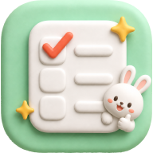
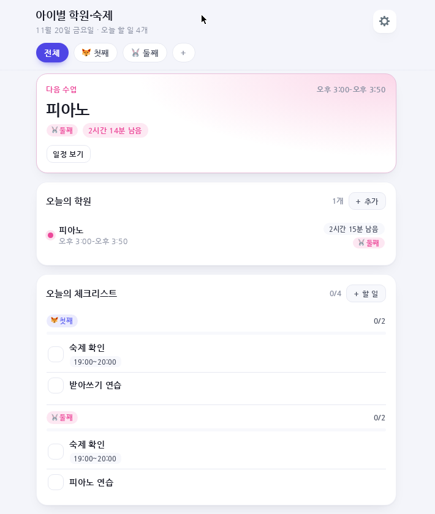
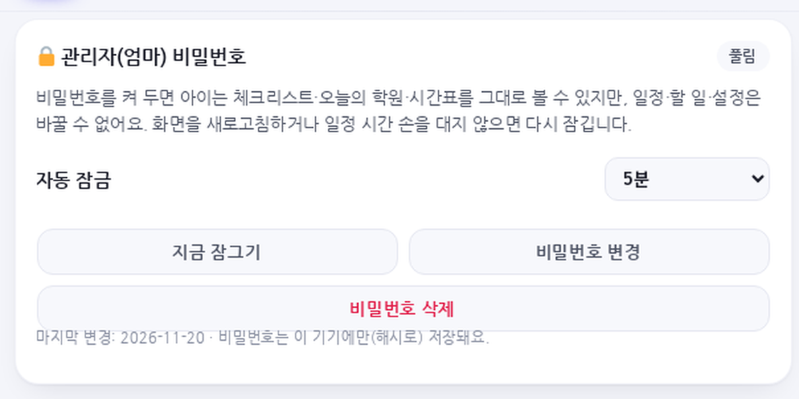
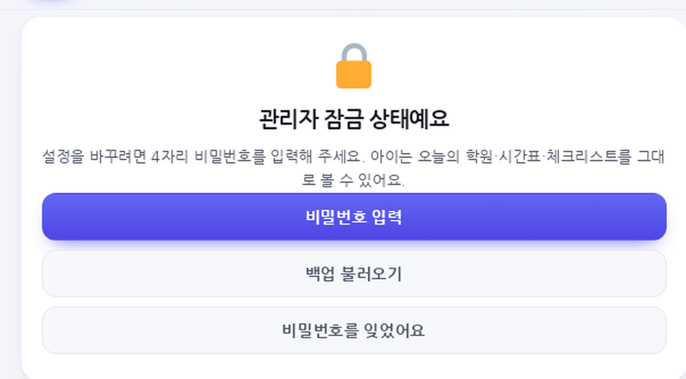

# 🐰 엄마다했쏙



아이들의 학원 시간표와 매일 학습 체크리스트를 한 화면에서 보는 휴대폰용 웹앱(PWA)입니다.
홈 화면 이름은 **엄마다했쏙**(짧은 이름 **다했쏙**)입니다.
서버나 설치 프로그램 없이 브라우저에서 바로 열리고, 입력한 내용은 그 휴대폰에만 저장됩니다.



## 바로 쓰는 방법

1. `standalone.html` 하나만 있으면 됩니다. 카카오톡/드라이브로 휴대폰에 보낸 뒤 파일을 눌러 크롬으로 엽니다.
2. 크롬 오른쪽 위 **⋮ → 홈 화면에 추가**를 누르면 앱처럼 아이콘이 생깁니다.
3. 홈 화면 아이콘으로 열면 주소창 없는 전체 화면으로 뜹니다.

> 파일로 열면 브라우저에 따라 저장이 유지되지 않을 수 있습니다. 계속 쓰려면 아래처럼 인터넷 주소로 올려 두는 것을 권합니다.

## 인터넷 주소로 올리기 (GitHub Pages)

1. 이 폴더(`apps/academy-manager/`)의 파일을 GitHub 저장소에 올립니다.
2. 저장소 **Settings → Pages → Branch: main / (root)** 를 선택해 저장합니다.
3. `https://<아이디>.github.io/<저장소>/index.html` 을 휴대폰 크롬으로 열고 **홈 화면에 추가**를 누릅니다.

`index.html` + `styles.css` + `logic.js` + `app.js` + `manifest.json` + `sw.js` + 아이콘 4개를 같은 폴더에 두면 됩니다.
서비스워커(`sw.js`)가 파일을 캐시하므로 한 번 열어 두면 인터넷이 느릴 때도 뜹니다.

## 화면

| 탭 | 내용 |
| --- | --- |
| 오늘 | 다음 수업과 남은 시간, 오늘의 학원, 오늘의 체크리스트, 마감 숙제 |
| 시간표 | 월~일 주간 시간표, **📊 한눈에 보기(주간 표)**, 등록된 학원 목록(수정·삭제) |
| 숙제 | 오늘의 체크리스트(아이 한 명 진행률), 마감일이 있는 숙제(미완료/전체/완료) |
| 설정 | **관리자(엄마) 비밀번호**, 알림, 캘린더(.ics) 내보내기·불러오기, 데이터 백업/복원, 예시 계획표, 홈 화면 추가 안내 |

- 상단 **전체 / 아이 이름** 칩으로 아이를 골라 볼 수 있습니다. `＋` 로 아이를 추가합니다.
- 체크리스트는 **날짜별**로 저장되어 자정이 지나면 새로 시작합니다. 지난 기록은 30일 뒤 자동 정리됩니다.
- 숙제는 마감일 기준으로 `오늘 마감`, `내일 마감`, `D-3`, `2일 지남` 처럼 강조됩니다.

## 한눈에 보기 (주간 표)

시간표 탭 위 **📊 한눈에 보기** 를 누르면 이번 주 시간표가 **월~일 × 시간대 격자 표**로 펼쳐집니다.

- **가로축**: 시간 열 + 월·화·수·목·금·토·일. **세로축**: 등록된 일정의 처음~끝 시간에 맞춘 1시간 단위 행(예: `16시~17시`).
- **엑셀 시간표처럼 또렷한 격자**: 시간대마다 가로선, 요일마다 세로선이 또렷하게 서고, 짝수 시간대는 옅은 띠로 구분됩니다. 1시간 행 높이와 칸 여백을 넉넉히 잡아 위아래 수업이 붙어 보이지 않습니다.
- 시간이 정해지지 않은 일정은 표 맨 위 **종일/메모** 줄에 이름표로 모입니다.
- 1시간 넘게 걸리는 수업은 두 칸에 걸쳐 이어지고, **학원 이름마다 늘 같은 파스텔 색**이라 한눈에 구분됩니다.
  같은 시간에 두 일정이 겹치면 두 칸으로 나누어 나란히 보여 줍니다.
- 아이가 2명 이상이면 위쪽에서 **👥 모든 아이**(아이마다 표 하나, 태블릿에서는 나란히)와 **한 아이만**을 오갈 수 있습니다.
- **토·일 숨기기 / 보기**: 주말 일정이 없으면 처음부터 월~금만 보여 주고, 버튼으로 언제든 7일 모두 볼 수 있습니다.
- **📱 한눈에 / 🔍 크게 보기**: 폰(360~430px)에서도 월~일 7칸이 화면 폭에 맞춰 한 번에 들어옵니다(시간 열 `16시` 한 줄 표기, 칸 너비 자동). 글자가 작게 느껴지면 **🔍 크게 보기**로 전환하면 칸과 글자가 커지고, 넘치는 부분은 옆으로 넘겨 봅니다. 고른 방식은 다음에 열 때도 그대로입니다.
- 태블릿·가로 화면에서는 칸과 글자가 더 커지고, 두 아이 표가 나란히 들어갑니다.
- 칸을 누르면 그 일정이 열립니다. **보기(읽기)는 관리자 비밀번호 없이** 되고, 고치려 할 때만 비밀번호를 묻습니다.
- **🖨️ 인쇄/PDF** 로 냉장고에 붙일 종이 시간표를 만들 수 있습니다(가로 A4, 색 그대로).

## 관리자(엄마) 비밀번호 잠금

아이가 일정이나 숙제 목록을 함부로 고치지 못하게 4자리 숫자 비밀번호로 잠글 수 있습니다.



- **자유롭게 되는 것**: 오늘 화면·시간표·숙제 보기, **📊 한눈에 보기(주간 표) 보기**, 아이 탭 전환, 체크리스트·숙제 완료 체크와 해제.
- **비밀번호가 필요한 것**: 설정 화면, 아이·학원 일정·할 일·숙제의 추가/수정/삭제, 예시 계획표 불러오기, 전체 삭제.
- 잠긴 상태에서 일정을 누르면 **보기 전용** 창이 열립니다(내용은 그대로 보이고, “비밀번호 입력하고 수정”으로 이어서 고칠 수 있어요).
- 설정 맨 위 **🔒 관리자(엄마) 비밀번호** 카드에서 설정·변경·삭제할 수 있고, 자동 잠금 시간(1/5/10/30분, 또는 자동 잠금 없음)을 고를 수 있습니다.
- 상단 🔒/🔓 버튼으로 바로 잠그거나 풀 수 있습니다. 화면을 새로고침하면 항상 다시 잠깁니다.
- 비밀번호는 평문으로 저장하지 않고 **salt + SHA-256 반복 해시**만 기기에 저장합니다. 5번 틀리면 30초 동안 입력이 막힙니다.
- 처음 상태에는 비밀번호가 없어서 그대로 쓰면 되고, 백업을 복원해도 예전 백업(비밀번호 정보가 없는 파일)은 그대로 열립니다.
- 비밀번호를 잊으면 이 기기의 앱 데이터를 초기화한 뒤(잠금도 함께 사라짐) 백업 파일을 불러오면 됩니다. 백업을 불러오면 잠금이 풀린 상태로 시작하니, 필요하면 비밀번호를 다시 설정해 주세요.
- 4자리 숫자 잠금은 아이의 실수·장난을 막는 수준의 잠금이며, 기기 자체의 잠금(화면 잠금)을 대신하지는 않습니다.



## 처음 열었을 때

처음 열면 아이가 하나도 없는 빈 상태로 시작합니다. **아이 추가하기**로 이름을 넣고 학원·체크리스트를 등록하면 됩니다.
어떻게 쓰는지 먼저 둘러보고 싶으면 **예시 계획표로 둘러보기**를 누르세요(아이 2명 · 학원 6개 · 할 일 6개의 익명 예시).
설정 → **예시 계획표** 로 언제든 다시 불러올 수 있습니다. 예시는 실제 사용 데이터가 아니라 안내용 샘플입니다.

## 알림과 캘린더

- **알림**: 설정에서 권한을 허용하면 학원 시작 N분 전(10/15/30/60분)과 숙제 마감 시각에 브라우저 알림을 보냅니다.
  앱을 열어 둔 동안에만 동작합니다(휴대폰 브라우저의 백그라운드 알림 제한).
- **캘린더(.ics)**: 설정 → 캘린더로 내보내기에서 `학원+숙제` / `학원 일정` / `숙제 마감` 파일을 내려받아 누르면
  안드로이드 기본 캘린더에 등록됩니다. 학원은 매주 반복 일정으로 들어가고, 알림(30분 전 등)도 함께 들어갑니다.
  숙제 마감과 시간 미정 일정은 종일 일정으로 들어갑니다.
- 상단에서 아이를 고른 상태로 내보내면 그 아이 일정만 들어갑니다.

## 캘린더(.ics) 불러오기

구글 캘린더에 이미 정리해 둔 학원 일정을 앱 시간표로 한 번에 옮길 수 있습니다.

1. 구글 캘린더 **웹** → ⚙️ 설정 → **가져오기 및 내보내기** → **내보내기** 로 `.ics` 파일을 받습니다.
   (압축(zip)으로 받아지면 풀어서 `.ics` 파일을 씁니다.)
2. 앱 **설정 → 데이터** 또는 **시간표** 화면 위의 **📅 구글 캘린더(.ics) 불러오기** 버튼을 누르고 그 파일을 고릅니다.
   관리자 비밀번호가 걸려 있으면 먼저 비밀번호를 입력합니다.
3. 미리보기에서 넣을 일정을 고르고(체크 해제로 빼기), **어느 아이 시간표에 넣을지** 고른 뒤 **넣기**를 누릅니다.
   아이가 아직 없으면 이름을 적어 새 아이를 만들면서 넣을 수 있습니다.

- `SUMMARY`(제목) · `DTSTART`/`DTEND`(시작·끝) · `LOCATION`(장소) · `DESCRIPTION`(메모) 를 읽습니다.
  UTC(`...Z`) 시각은 한국 시간으로 바꾸고, 종일 일정(`VALUE=DATE`)은 **시간 미정**으로 넣습니다.
- `RRULE:FREQ=WEEKLY` 는 `BYDAY` 의 요일들로, `BYDAY` 가 없으면 시작일의 요일로 넣습니다.
  반복이 아닌 **단발 일정**은 그 날짜의 요일로 들어갑니다(시간표가 요일 기준이라서, 그 주에도 함께 보입니다).
- 이 앱이 내보낸 `.ics` 도 그대로 다시 읽힙니다. 제목 앞 `[아이 이름]` 은 그 아이 시간표로 들어가고,
  `[숙제]` 로 시작하는 숙제 마감은 학원 일정이 아니라서 건너뜁니다.
- **이미 있는 일정은 건너뛰기**가 기본으로 켜져 있어, 같은 아이·같은 이름·같은 요일·같은 시간의 일정은
  다시 들어가지 않습니다. 겹치는 요일만 빼고 나머지 요일은 넣습니다.

## 데이터

- 모든 내용은 브라우저 `localStorage`(`academy-manager:v1`)에 저장됩니다. 서버로 나가지 않습니다.
- 휴대폰을 바꾸기 전에 설정 → **백업 저장**으로 JSON 파일을 받아 두고, 새 기기에서 **백업 불러오기**로 복원하세요.
  백업 파일에는 관리자 비밀번호도 함께(해시로) 담기며, 불러온 직후에는 잠금이 풀린 상태로 시작합니다.
- 같은 학원이라도 요일마다 시간이 다르면 시간대별로 나누어 등록합니다. 시간이 정해지지 않은 일정은 시작 시간을 비워 두면 **시간 미정**으로 표시됩니다.
- **전체 삭제**는 되돌릴 수 없습니다.

## 파일 구성

```
index.html            앱 화면 (외부 파일 참조)
styles.css            스타일 (라이트/다크 모드 지원)
logic.js              날짜·시간 계산, .ics 생성·읽기 (화면과 무관한 순수 로직)
app.js                상태 저장, 화면 렌더링, 이벤트
manifest.json         PWA 매니페스트
sw.js                 오프라인 캐시 서비스워커
icon.svg / *.png      앱 아이콘
standalone.html       위 파일을 모두 합친 단일 파일 (배포·전송용)
build.py              index.html + css + js → standalone.html 재생성
tools/make_icons.py   아이콘 PNG 재생성
tests/run_tests.py    자동 검증 (문법·계산·렌더·표 보기·.ics·잠금·예전 백업 호환)
tests/fixtures/       불러오기 검사용 예시 .ics (익명)
tests/render_preview.py  디자인 미리보기(tests/preview.html) 생성
```

## 고치고 다시 만들기

```bash
cd apps/academy-manager
python3 build.py                 # standalone.html 재생성
python3 tests/run_tests.py       # 문법·계산·렌더·.ics 검증
python3 tests/render_preview.py  # 미리보기 갱신
```

`index.html`, `styles.css`, `logic.js`, `app.js` 를 고친 뒤 `build.py` 를 실행하면 `standalone.html` 도 함께 갱신됩니다.
